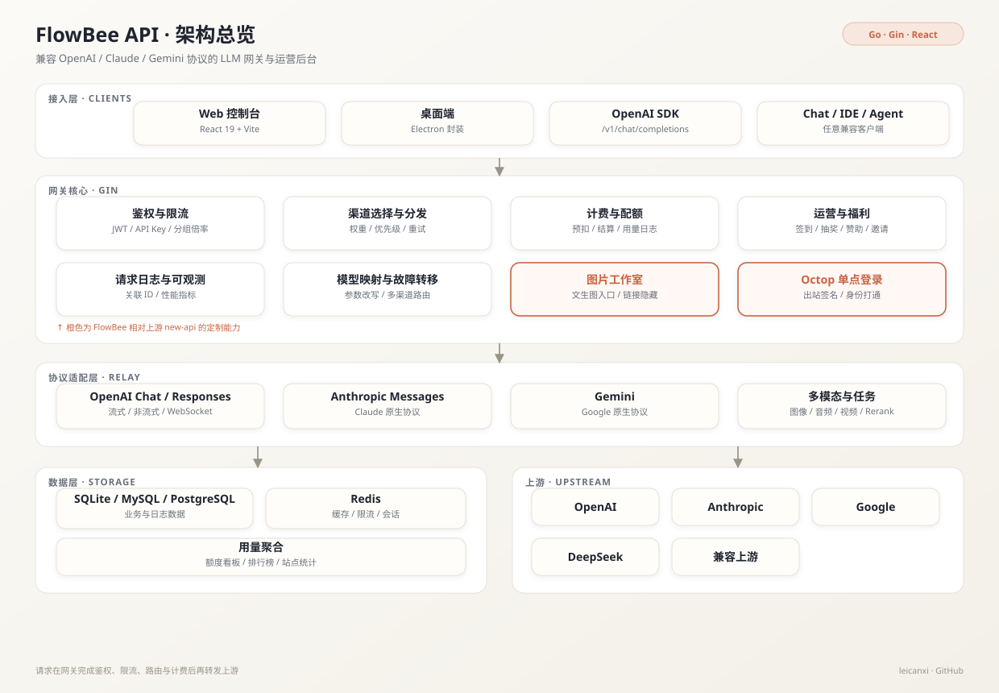
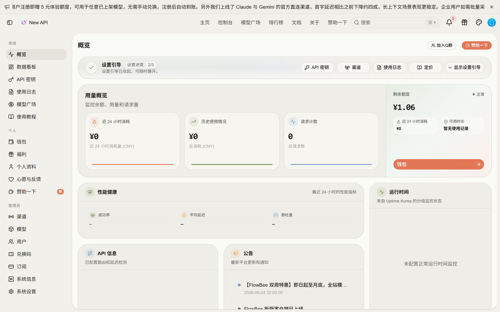
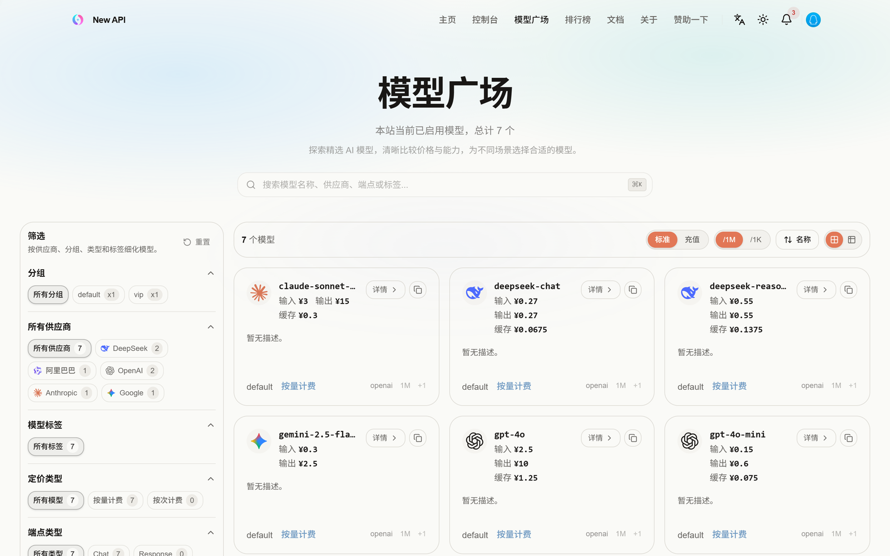

<div align="center">
  
  <h1>FlowBee API</h1>
  <p><strong>一个跑在 2 核 / 1.9G 小机器上的多模型 LLM 网关</strong></p>
  <p>OpenAI / Claude / Gemini 协议兼容 · 多渠道聚合 · 计费与限流 · 运营后台</p>

  <p>
    
    
    
    
    
    
  </p>

  <p>
    <a href="https://flowbee.top">线上服务</a> ·
    <a href="#架构">架构</a> ·
    <a href="#界面">界面</a> ·
    <a href="#快速开始">快速开始</a> ·
    <a href="README.zh_CN.md">上游完整文档</a>
  </p>
</div>

> [!NOTE]
> 本仓库是 [QuantumNous/new-api](https://github.com/QuantumNous/new-api) 的二次开发分支，为 [FlowBee](https://flowbee.top) 的生产环境维护。上游提供协议兼容与网关底座；本分支聚焦**计费、限流、渠道亲和、运营能力和品牌化**。上游的完整部署与渠道配置文档见 [README.zh_CN.md](README.zh_CN.md)。

## 为什么做这个项目

FlowBee 需要把 DeepSeek、Claude、GPT、Gemini、Qwen 等多家上游收口成**一个 OpenAI 兼容入口**，同时自己掌握计费、限流和路由。直接采购聚合服务无法控制成本与故障边界，因此选择一个成熟网关做二次开发，而不是从零写协议层。

目标很具体：

- 一个 Base URL 接入主流客户端与 SDK；
- 上游按渠道管理，支持权重、优先级、分组和故障转移；
- 计费可核对，限流可解释，故障可归因；
- 在低配机器上稳定运行，并能持续跟上游版本升级。

## 相对上游的定制

| 能力 | 说明 | 主要位置 |
|---|---|---|
| 图片工作室 | 网页端文生图入口，后端将结果转为 base64，隐藏上游临时链接 | `controller/`、`relay/`、`web/src/routes/_authenticated/image-studio/` |
| 渠道亲和 | 按用户 / 会话绑定渠道，配合多 key 拆分提升上游前缀缓存命中率 | `service/channel_affinity.go`、`service/channel_select.go` |
| 余额分档限流 | 按账户余额与福利等级设置不同速率，防止免费额度被刷穿 | `middleware/model-rate-limit.go`、`setting/rate_limit.go` |
| 表达式计费 | 支持按时段 / 缓存 / 输入输出分别计价的表达式，覆盖峰谷价 | `pkg/billingexpr/`、`service/billing*.go` |
| Octop SSO | 出站签名 + 身份打通，与自有 Agent 平台共享登录态 | `oauth/`、`web/src/routes/_authenticated/sso/octop.tsx` |
| 运营体系 | 签到、福利积分、抽奖、赞助墙、邀请奖励、个人 token 用量榜 | `controller/`、`model/`、`web/src/features/` |
| 品牌化 | Logo、主题、公告、邮件外壳、更新检查均指向 FlowBee | `web/`、`common/`、`setting/` |

## 架构

<p align="center">
  
</p>

- **接入层**：Web 控制台、Electron 桌面端、任意 OpenAI SDK 与兼容客户端。
- **网关核心**：Gin 承载鉴权、限流、渠道选择、计费与日志；请求在进入上游前完成分组倍率、模型映射和参数改写。
- **协议适配**：将 OpenAI Chat / Responses、Anthropic Messages、Gemini 以及图像 / 音频 / 视频 / Rerank 统一到内部请求模型，再按渠道类型转发。
- **数据层**：SQLite 适合单机低配部署，MySQL / PostgreSQL 支持多实例；Redis 可选，用于缓存、限流与会话协调。

## 界面

以下截图来自本地全新实例（复制生产库结构 + 7 个演示模型，不含任何用户数据）。

| 管理后台 | 模型广场 |
|:---:|:---:|
|  |  |

## 线上运行数据

以下为个人生产实例的真实采样，用于说明系统在低配环境下的表现：

| 指标 | 数值 | 说明 |
|---|---:|---|
| 7 天请求量 | 27,483 | 单实例、2 核 / 1.9G |
| 平均处理耗时 | 20 ms | `logs.use_time` 均值，最大 3.3 s |
| 前缀缓存命中率 | 52.9% → 67.4% | 渠道拆分 + 按用户亲和，33 小时 / 2,049 请求 |
| 线上迁移 | 1 次 | rsync + SQLite `integrity_check` + sha256 校验 + DNS 切换 + 回滚预案 |

## 快速开始

### 环境要求

- Go 1.25+
- Node.js 20+ 与 [Bun](https://bun.sh/)（构建前端）
- 可选：MySQL / PostgreSQL、Redis、Docker

### 从源码启动

```bash
git clone https://github.com/leicanxi/flowbee-api.git
cd flowbee-api

cp .env.example .env

# 构建并嵌入前端
cd web
bun install
bun run build
cd ..

# 默认使用当前目录的 SQLite
go run main.go
```

访问 `http://localhost:3000`。首次启动且数据库为空时，会创建管理员 `root` / `123456`，**请立即修改密码**。

### Docker

```bash
docker build -t flowbee-api .

docker run -d --name flowbee-api \
  -p 3000:3000 \
  -v "$PWD/data:/data" \
  -e TZ=Asia/Shanghai \
  flowbee-api
```

### 常用环境变量

| 变量 | 默认 | 说明 |
|---|---|---|
| `PORT` | `3000` | 监听端口 |
| `SQLITE_PATH` | `one-api.db` | SQLite 路径；不设置 `SQL_DSN` 时生效 |
| `SQL_DSN` | 空 | MySQL / PostgreSQL 连接串 |
| `REDIS_CONN_STRING` | 空 | 多实例缓存、限流与会话协调 |
| `SESSION_COOKIE_SECURE` | 空 | 生产环境必须为 `true`（HTTPS） |
| `TRUSTED_PROXIES` | 回环 / 内网 | 反向代理场景建议显式配置 |
| `FRONTEND_BASE_URL` | 空 | 前后端分离部署时的前端地址 |

## 项目结构

```text
main.go             入口：初始化资源、启动 HTTP 服务
router/             API、Relay、Dashboard、Web 路由
middleware/         鉴权、限流、渠道分发、CORS、日志
controller/         管理端与业务 API
relay/              各上游协议适配与流式转发
service/            渠道选择、计费、配额、亲和、任务
model/              ORM 模型与持久化
setting/            动态配置（计费、限流、运营）
oauth/              SSO / 第三方登录
web/                React 管理台（构建产物嵌入二进制）
pkg/billingexpr/    表达式计费引擎
```

## 关键设计

1. **统一请求模型**：不同上游的协议先转换为内部 DTO，再由各 handler 转成目标协议；流式响应保持 SSE 增量透传。
2. **渠道选择**：按分组、模型、优先级、权重筛选，叠加亲和与重试策略；失败时按状态码决定切换渠道还是直接返回。
3. **计费一致性**：请求前预扣、结束后按实际 token 结算并写日志；表达式计费支持峰谷时段、缓存 token 和输入输出分别计价。
4. **限流分层**：用户、令牌、分组、余额档位四个维度组合，避免单点限流被绕过。
5. **低配部署**：SQLite 开启 WAL 与 busy timeout，单机即可承载；需要横向扩展时切换到 MySQL / PostgreSQL + Redis。
6. **可观测**：请求日志记录渠道、模型、耗时、token 与错误码，配合站点统计和性能指标定位问题。

## 测试

```bash
go test ./...
```

仓库内包含渠道选择、亲和、限流、计费、任务与路由的单元测试；涉及真实上游的端到端验证需要自备渠道密钥。

## 与上游同步

```bash
git remote add upstream https://github.com/QuantumNous/new-api.git
git fetch upstream
git merge upstream/main
```

冲突主要集中在 `controller/`、`service/`、`middleware/` 与 `web/` 的定制文件。建议先跑 `go build ./...` 与前端构建，再按模块逐个合并。

## 许可与致谢

本项目遵循 **GNU Affero General Public License v3.0**，详见 [LICENSE](LICENSE) 与 [NOTICE](NOTICE)。

- 上游项目：[QuantumNous/new-api](https://github.com/QuantumNous/new-api)
- 本分支的修改与定制由 [leicanxi](https://github.com/leicanxi) 维护，部署于 [flowbee.top](https://flowbee.top)。

> 如果你也在做多模型网关，欢迎交流渠道选择、计费一致性与低配部署的实践。
